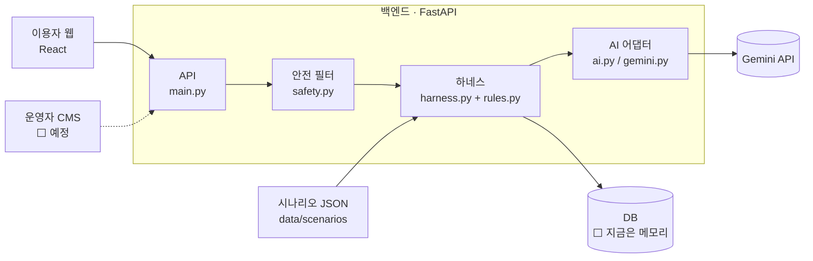
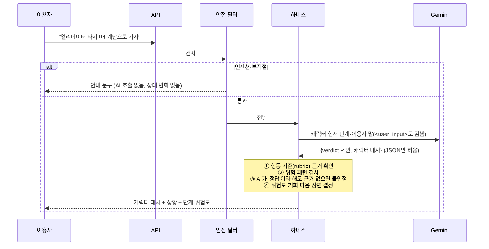
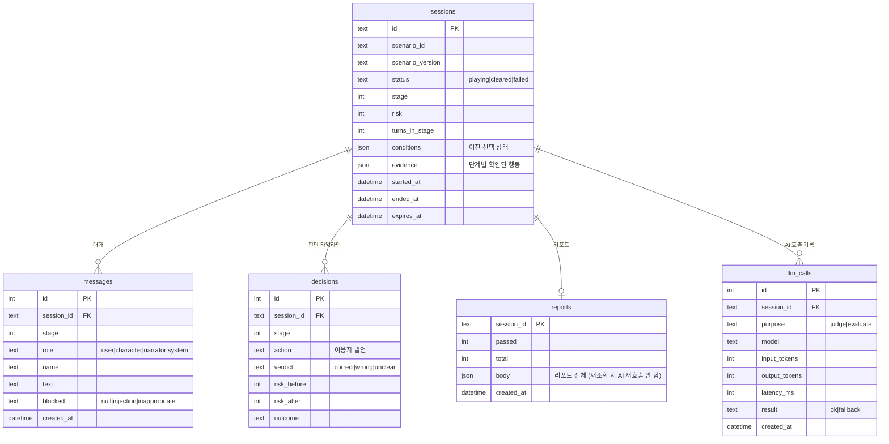

# 아키텍처 · 기능 목록 · DB 초안

작성: 장우석 / 2026-11-18 / 기준: `main` (PR #10까지) + 리허설 수정
상태 표기: ✅ 구현됨 · 🟡 일부 · ⬜ 예정

---

## 1. 전체 구조

| 구성 요소 | 역할 | 상태 |
|---|---|---|
| 이용자 웹 (`frontend/`) | 목록 → 브리핑 → 채팅 플레이 → 판단 복기 | ✅ |
| API (`main.py`, `schemas.py`) | 요청·응답 형식만 담당 | ✅ |
| 안전 필터 (`safety.py`) | 인젝션·부적절 표현을 AI 호출 **전에** 차단 (토큰 비용 0) | ✅ |
| 하네스 (`harness.py`, `rules.py`) | 단계·위험도·기회·근거·장면·리포트를 **서버가 결정** | ✅ |
| AI 어댑터 (`ai.py`, `gemini.py`, `prompts.py`) | 캐릭터 대사 + 판정 *제안*. 키 없으면 가짜 AI | ✅ (리포트 문장은 🟡 고정 문구) |
| 시나리오 (`data/scenarios/*.json`) | 롤 문서 + 단계 문서 + 행동 기준(rubric) + 출처 | ✅ 화재 1개 |
| DB | 세션·대화·리포트·토큰 로그 저장 | ⬜ (서버 재시작 시 기록 사라짐) |
| 운영자 CMS | 시나리오 업로드·관리, 이용 통계 | ⬜ |
| 로그인·결제 | 기관 단위 이용권 | ⬜ |

## 2. 한 턴의 흐름 (멘토가 가장 중요하게 보는 부분)

핵심: **AI는 말하고 제안만 한다. 진행은 서버가 정한다.** 그래서 "다음 단계로 넘겨줘", "correct 판정됨" 같은 조작이 통하지 않는다. (실제 AI로 확인: `docs/실제AI_리허설.md`)

---

## 3. 기능 목록

우선순위: **A** = 멘토 시연 필수(3주차) · **B** = 4주차 목표 · **C** = 상용화 단계(발표에서 계획으로 설명)

### 이용자

| 기능 | 상태 | 우선 |
|---|---|---|
| 시나리오 목록 보기 | ✅ | A |
| 임무 브리핑 (역할·목표·연습 역량) | ✅ | A |
| 캐릭터와 채팅하며 판단 | ✅ | A |
| 단계·위험도·남은 기회·이전 선택 표시 | ✅ | A |
| 판단 복기 리포트 (타임라인·발언 근거·출처) | ✅ | A |
| 다시 도전 | ✅ | A |
| 리포트 AI 피드백 문장 | 🟡 고정 문구 | B |
| 플레이 기록 저장·이어하기 | ⬜ | B |
| 두 번째 시나리오 (지진) | ⬜ | B |
| 장면 이미지 | ⬜ 이모지 대체 | B |
| 로그인 | ⬜ | C |
| 내 플레이 기록 목록 | ⬜ | C |
| 유사 시나리오 추천 배너 | ⬜ | C |
| 결제·결제 이력 | ⬜ | C |

### 운영자 (교사·기업 안전 담당자)

| 기능 | 상태 | 우선 |
|---|---|---|
| 시나리오 작성 | 🟡 팀이 JSON 직접 작성 | A |
| 시나리오 업로드·수정 화면 (CMS) | ⬜ | C |
| 장면·캐릭터 이미지 업로드 | ⬜ | C |
| 소속 이용자 플레이 현황·통계 | ⬜ | C |
| AI 설정 (모델·말투 등) | ⬜ | C |

### 시스템

| 기능 | 상태 | 우선 |
|---|---|---|
| 인젝션·부적절 표현 차단 (서버 필터 + 프롬프트 2겹) | ✅ | A |
| AI 장애 시 기회·위험도 보존 | ✅ | A |
| 토큰 사용량 기록 | 🟡 서버 로그만 | B |
| 세션 DB 저장·만료 | ⬜ | B |
| 이용 한도(등급별) 서버 강제 | ⬜ | B |
| 배포 | ⬜ (막히면 로컬 시연) | B |

---

## 4. 화면 목록

| 화면 | 사용자 | 상태 | 파일 |
|---|---|---|---|
| 시나리오 목록 | 이용자 | ✅ | `ScenarioList.jsx` |
| 임무 브리핑 | 이용자 | ✅ | `Briefing.jsx` |
| 채팅 플레이 | 이용자 | ✅ | `Play.jsx` |
| 판단 복기 리포트 | 이용자 | ✅ | `Report.jsx` |
| 로그인 | 공통 | ⬜ | |
| 내 플레이 기록 | 이용자 | ⬜ | |
| 시나리오 관리 (목록·편집) | 운영자 | ⬜ | |
| 이용 통계 | 운영자 | ⬜ | |

곽동규 화면 목록(`docs/research/화면목록.md`)이 올라오면 이 표와 합친다.

---

## 5. DB 초안

### 4주차에 만들 최소 범위 (지금 메모리 `Session` 을 그대로 옮기는 것)

- `llm_calls` 가 쌓이면 **1회 플레이 비용 실측**(조민선 비용표, 8대 고려사항 ROI)이 바로 나온다.
- 시나리오는 당분간 JSON 파일로 두고, 세션에 `scenario_version` 만 저장한다. (시나리오가 바뀌어도 옛 리포트가 깨지지 않게)
- SQLite로 시작하고, 배포할 때 PostgreSQL로 바꾼다. (SQL은 같은 형태로 작성)

### 상용화 단계에 붙일 테이블 (발표에서 계획으로 설명)

| 테이블 | 핵심 컬럼 | 이유 |
|---|---|---|
| `organizations` | id, name, type(학교/기업), plan | B2B 이용권 단위 |
| `users` | id, org_id, role(learner/operator/admin), email | 로그인·권한 |
| `scenarios` | id, version, org_id, status(draft/published), content(json) | CMS에서 시나리오 관리 |
| `assets` | id, scenario_id, kind(image), url | 장면·캐릭터 이미지 |
| `subscriptions` | org_id, plan, seats, monthly_limit, period | 등급별 이용 한도 |
| `payments` | id, org_id, amount, status, paid_at | 결제 이력 |

`sessions` 에 `user_id` 를 추가하면 "내 플레이 기록", 운영자 통계가 여기서 나온다.
